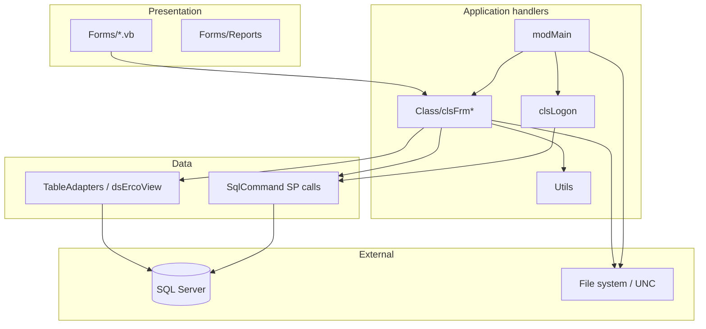
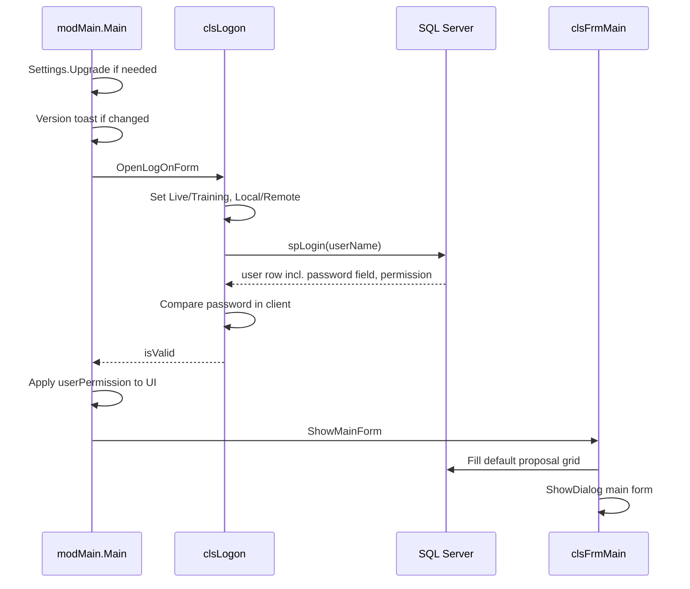

# Architecture

## Summary

ErcoView is a classic **smart client**:

- UI: WinForms + DevExpress controls  
- Logic: VB classes that own forms and call SQL  
- Data: SQL Server **stored procedures** + typed DataSet TableAdapters  
- State: process-wide module variables after login  

There is no separate service layer, no DI container, and no automated test project in-repo.

## Solution structure

```text
ErcoView.sln
├── ErcoView/                 # WinExe (startup: Sub Main)
│   ├── modMain.vb            # Entry, globals, connection string, layouts helpers
│   ├── Class/                # Handlers / controllers for forms
│   ├── Forms/                # Views (+ Reports/)
│   ├── DataSets/             # dsErcoView typed DataSet + TableAdapters
│   ├── My Project/           # Assembly, settings, manifest
│   ├── Images/               # Icons and chrome
│   └── app.config            # Config (git-crypt encrypted)
├── ErcoViewSetup/            # Legacy MSI project (.vdproj)
├── secrets/                  # Runtime secrets (git-crypt)
└── docs/                     # This documentation
```

## Layering (logical)



| Layer | Responsibility | Examples |
|-------|----------------|----------|
| Forms | Layout, control events → raise custom events | `frmMain`, `frmProposal` |
| Handlers | Validation, SP calls, fill grids, open child forms | `clsFrmMain`, `clsFrmProposal` |
| Utils / module | Cross-cutting lookups, connection, globals | `Utils`, `modMain` |
| DataSet | Designer-generated TableAdapters for list/report SPs | `spGetProposalsTableAdapter` |
| SQL | Business rules + persistence (mostly opaque in this repo) | `spUpdateProposal`, `spLogin` |

## Design pattern: form + handler

CRUD entities implement:

```text
IErcoTableHandler
  ShowForm()
  SetValues() As Boolean
  SaveEvent()
  InsertRow()
  UpdateRow()

clsBase : IErcoTableHandler
  ID As Integer
  didUpdate As Boolean
```

Concrete handlers inherit `clsBase` (except some specialized ones like list/main/logon).

| Handler | Form | Notes |
|---------|------|--------|
| `clsLogon` | `frmLogOn` | Auth; sets globals |
| `clsFrmMain` | `frmMain` | Shell: ribbon, grids, reports entry |
| `clsFrmProposal` | `frmProposal` | Largest business form |
| `clsFrmCustomer` | `frmCustomer` | |
| `clsFrmVendor` | `frmVendor` | Inherits customer path with `isVendor=1` |
| `clsFrmContact` | `frmContact` | |
| `clsFrmUsers` | `frmUser` | |
| `clsFrmList` | `frmList` | Multi-select up to 3 IDs |
| `clsFrmJobNumbers` | `frmJobNumbers` | |

**Rule of thumb for agents:** change behavior in `Class/clsFrm*.vb` first; keep `Forms/*.vb` thin unless adding UI controls.

## Application startup sequence



## Connection model

Runtime connection strings are **built in code**, not taken wholesale from the many design-time strings in `app.config`.

```text
GetConnectionString()
  database = Live ? ErcoView_Live : ErcoView_Training
  host     = Local ? My.Settings.localIP : My.Settings.remoteIP
  user/pwd = secrets/sql.env  (SQL_USER, SQL_PASSWORD)
```

Credential file search paths (relative to `BaseDirectory`) include `secrets\sql.env` and several parent `..\secrets\` locations for dev vs deploy layouts.

TableAdapters still have designer connection metadata; handlers typically assign:

```vb
.SomeTableAdapter.Connection = New SqlConnection(GetConnectionString())
```

before `Fill`.

## Global process state

Defined in `modMain`:

| Symbol | Meaning |
|--------|---------|
| `currentErcoViewUserName` | Login name |
| `currentErcoViewUserID` | User id (default 1 before login — do not trust pre-login) |
| `currentErcoViewFullName` | Display name |
| `userPermission` | 1 Admin, 2 General, 3 Superintendent |
| `isDatabaseLive` | Live vs Training |
| `isLocalDatabase` | Local vs Remote host |

These are **not** thread-safe multi-user in-process state; one desktop session = one user.

## UI shell

`frmMain` is a ribbon application with tab pages for:

- Proposals (default)
- Customers
- Users (admin)
- Vendors
- Contacts
- Groups

Switching ribbon pages fills the corresponding TableAdapter. Detail editing opens modal handler forms.

## Reporting

DevExpress XtraReports under `Forms/Reports/`. Setup dialogs (year/month) call report-specific SPs (`spGetBookings`, `spRptConstSch`, etc.). Report adapters must receive `GetConnectionString()` like grids.

## Mapping

Selected proposal rows → KML via template `ErcoViewTemplate.kml` copied beside the EXE → `clsMapIt` injects placemarks → external process opens the KML.

## Cross-cutting utilities

`Utils.vb` resolves multi-select foreign keys (up to three IDs) into display strings using many small SPs (`spGet*ById`, `spGet*OfProposalId`). This can cause **N+1 round-trips**; prefer expanding SP result sets when optimizing.

## Explicit non-goals of current architecture

- No REST API  
- No ORM unit-of-work beyond DataSet  
- No client-side DI / IoC  
- No automated UI tests in repo  
- Authorization is primarily **UI gating**, not hard SP enforcement (see [Security](security.md))  

## Related

- [Forms & handlers reference](reference/forms-and-handlers.md)  
- [Database](database.md)  
- [Development](development.md)  
