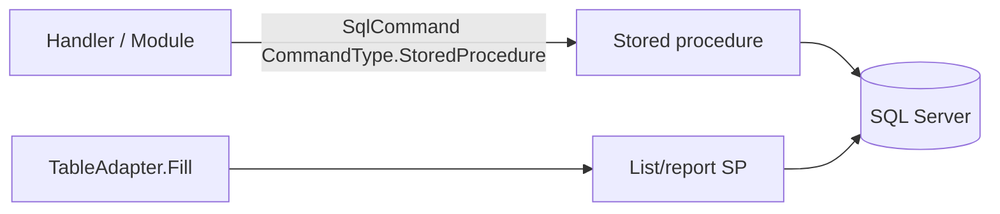

# Database

## Scope

ErcoView expects **Microsoft SQL Server** with application catalogs and a large set of **stored procedures**.  

This repository contains:

- Client call sites (`SqlCommand` + TableAdapters)  
- Typed DataSet schema for SP **result shapes** (`DataSets/dsErcoView.xsd`)  

It does **not** contain full table DDL or SP bodies. Treat the live server (or a scripted export) as source of truth for SQL.

## Catalogs

| Catalog | Use |
|---------|-----|
| `ErcoView_Live` | Production data |
| `ErcoView_Training` | Sandbox / training |

Selected at login (Database combo). Runtime builds:

```text
Initial Catalog = ErcoView_Live | ErcoView_Training
```

## Hosts

| Mode | Setting | Purpose |
|------|---------|---------|
| Local | `My.Settings.localIP` | Internal SQL instance |
| Remote | `My.Settings.remoteIP` | External SQL host |

Authentication for app data access uses SQL login credentials from **`secrets/sql.env`** (`SQL_USER`, `SQL_PASSWORD`), not Windows auth in the current runtime path.

Design-time `app.config` connection strings often use Integrated Security and historical server names; they are for designers / legacy and may not match runtime.

## How the client talks to SQL



1. **Direct SP calls** — insert/update/login/password/utils  
2. **TableAdapters** — grid and report fills defined in `dsErcoView.xsd`

Always set TableAdapter `.Connection` from `GetConnectionString()` before Fill when following existing patterns.

## Stored procedures (client inventory)

Authoritative detailed list: [reference/stored-procedures.md](reference/stored-procedures.md).

### By capability

| Capability | Examples |
|------------|----------|
| Auth | `spLogin`, `spUpdatePassword` |
| Users | `spGetUsers`, `spInsertUser`, `spUpdateUser`, `spGetPermissions` |
| Proposals | `spGetProposals`, `spGetNewProposalNumber`, `spInsertProposal2`, `spUpdateProposal` |
| Proposal parties | `spSet*`, `spDelete*`, `spGet*OfProposalId` |
| Customers | `spGetCustomer(s)`, `spInsertCustomer`, `spUpdateCustomer` |
| Vendors | `spGetVendor(s)`, … |
| Contacts | `spGetContact(s)`, `spInsertContact`, `spUpdateContact` |
| Groups | `spGetGroups`, `spInsertGroup`, `spGetGroupOfCustomerId` |
| Lookups | `spGetSalesman`, `spGetSuper`, `spGetJobTypes`, job number SPs |
| Reports | `spGetBookings`, `spRptConstSch`, `spRptConstSch2`, `spRptCompletedPrj`, `spReportRevenueByMonth`, `spGetProposalsByMonth` |

## Result shape example: proposals

`spGetProposals` returns a wide row used by the main grid and several reports (70+ columns), including denormalized `CUSTOMER_TEXT`, `SALESMAN_TEXT`, GPS, pricing, and status fields. See XSD mappings under `spGetProposals` in `dsErcoView.xsd`.

## Exporting schema (recommended for maintainers)

Scripts belong under [`db/`](../db/README.md). Run on a server you control and commit **non-secret** schema/procedure scripts only:

```sql
-- List procedures
SELECT ROUTINE_SCHEMA, ROUTINE_NAME
FROM ErcoView_Live.INFORMATION_SCHEMA.ROUTINES
WHERE ROUTINE_TYPE = 'PROCEDURE'
ORDER BY 1, 2;

-- List tables
SELECT TABLE_SCHEMA, TABLE_NAME
FROM ErcoView_Live.INFORMATION_SCHEMA.TABLES
WHERE TABLE_TYPE = 'BASE TABLE'
ORDER BY 1, 2;
```

Use SSMS **Generate Scripts** for definitions. Do not commit production data dumps with PII or passwords.

## Environments

| Environment | Catalog | Notes |
|-------------|---------|--------|
| Dev / learning | Training | Default recommendation |
| UAT | Training or copy of Live | Depends on org |
| Production | Live | Protect with change control |

Never point experimental branches at Live without intent.

## Consistency pitfalls

1. **Training connection strings in config** may still name the Live catalog historically — trust **runtime** `GetConnectionString()`.  
2. **Duplicate connection string entries** in `app.config` are legacy clutter.  
3. **Dead EF string** (`ErcoView_LiveEntities` / Model1) is unused by the WinForms path.  
4. **Client password check** assumes `spLogin` returns a password column — hashing requires coordinated SP + client change.  
5. Typo column names in client (e.g. `ONE_CALL_EXPERATION_DATE`) may match DB; rename only with migration.

## Related

- [Security](security.md)  
- [Operations](operations.md)  
- [Stored procedures reference](reference/stored-procedures.md)  
