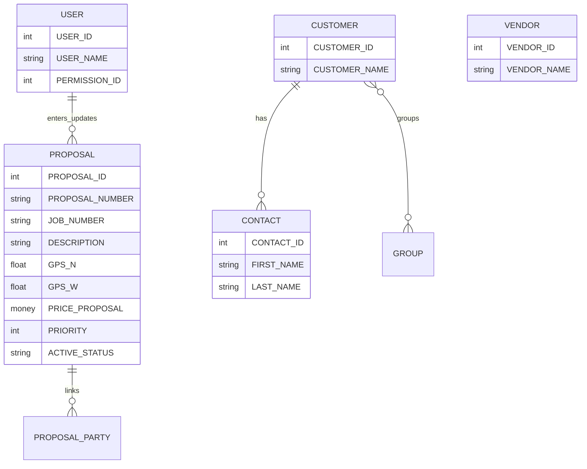

# Domain model

Conceptual model as implemented by the UI and stored procedures. Physical tables are defined in SQL Server (not fully present in this repo).

## Core concept: Proposal

A **Proposal** is a job opportunity or project record with:

- Identity: proposal number, optional job number  
- Description and free-text comments / notes  
- Geography: city, county, state, GPS N/W, mile point, body of water, directions  
- Commercial: proposal / permit / extra / actual prices, estimated cost/margin, profit fields  
- Regulatory / field: permits, one-call ticket and dates, pipe diameter, construction issues  
- Lifecycle: proposal status, job status, contract/permit status, priority, NOR and completion dates  
- Planning: book/construction month & year, estimated vs actual work days  
- Multi-party links (up to **three** of each in the client model)

Party “slots” used by the client:

| Slot type | Typical SP helpers |
|-----------|-------------------|
| Customer ×3 | `spGetCustomerOfProposalId`, `spSetCustomer` |
| Contact ×3 | `spGetContactOfProposalId`, `spSetContact` |
| Vendor ×3 | `spGetVendorOfProposalId`, … |
| Salesman ×3 | `spGetSalesmanOfProposalId`, … |
| Super ×3 | `spGetSuperOfProposalId`, … |
| Job type ×3 | `spGetJobTypeOfProposalId`, … |

UI multi-select is implemented by `clsFrmList` (max three selections). Display names are often denormalized into `*_TEXT` columns on `spGetProposals` results.

## Supporting entities

### Customer

Company customer: address, phones, website, notes, type, active flag, group membership text.

### Vendor

Same shape as customer in the app; `clsFrmVendor` inherits customer handling with `isVendor = 1`. May map to the same or parallel SQL objects—confirm in DB.

### Contact

Person with address/phones/email, linked `CUSTOMER_ID`.

### Group

Named group (`GROUP_ID`, `GROUP_NAME`) for classifying customers.

### User

Application user: name, username, **password** (historically plaintext in DB/UI), email, permission, salesman/super flags, active.

### Job type / job number

Lookups for classification and numbering sequences (`spGetNewJobNumber`, `spGetNewProposalNumber`).

### Permissions

Lookup via `spGetPermissions`. Client uses numeric levels:

| ID | Role | Observed UI behavior |
|----|------|----------------------|
| 1 | Admin | Full access; Users page; admin layout folder |
| 2 | General | No Users page; no New Customer; New Vendor allowed |
| 3 | Superintendent | No New Proposal; super layout folder; browse restrictions |

**Important:** These gates are enforced mainly in the client. Shared SQL credentials can still call SPs unless the database enforces roles.

## Status and priority fields

Proposal rows expose multiple status-like fields (proposal status, job status, contract status, permit status, priority, active). Exact enums live in SQL / combo data—treat as opaque strings/ints unless you dump lookup tables.

## Reports as read models

Reports are not separate entities; they are SP result shapes over proposals and related text fields:

| Report theme | Example SP |
|--------------|------------|
| Bookings | `spGetBookings` |
| Construction schedule | `spRptConstSch`, `spRptConstSch2` |
| Completed projects | `spRptCompletedPrj` |
| Revenue by month | `spReportRevenueByMonth` |
| Proposal by month | `spGetProposalsByMonth` |
| Hot seat / NOR / order received | Often `spGetProposals` filtered in report |

## Invariants (practical)

1. Prefer **Training** for experiments.  
2. Proposal numbers come from `spGetNewProposalNumber` — do not invent collisions in client-only code.  
3. Multi-party fields are **capped at three** in the current UI.  
4. GPS fields drive map export; empty GPS yields poor maps, not necessarily errors.  
5. Soft-delete / active flags (`ACTIVE`, `ACTIVE_STATUS`) may hide rows without physical delete.

## Glossary link

Short definitions: [glossary.md](glossary.md).
