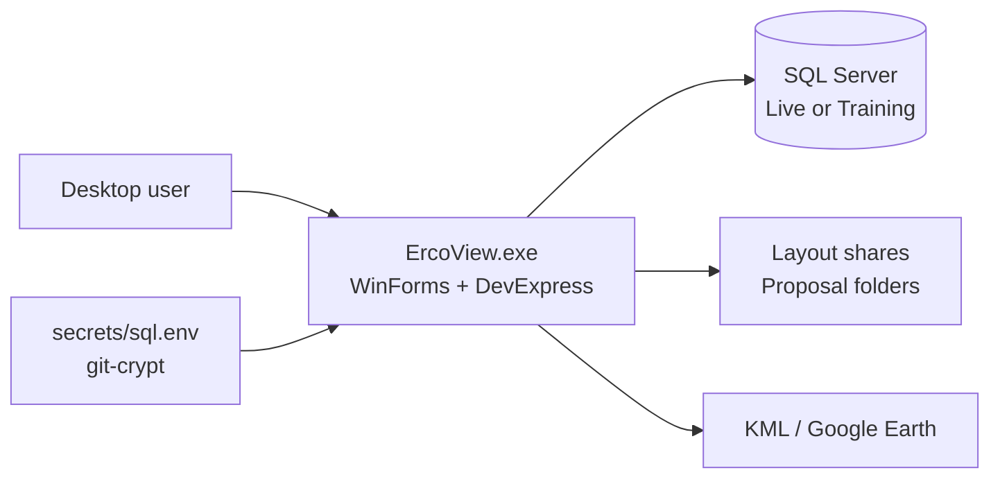

# Overview

## What is ErcoView?

**ErcoView** (also labeled **EV2** in the UI) is a Windows desktop application used by **Er-Con Technologies** (IMAGE CES lineage) to manage **construction / environmental proposals and related CRM data**.

It is not a web app. Users install a WinForms executable, log on against SQL Server, and work with ribbon-driven grids, detail forms, DevExpress reports, and optional Google Earth (KML) mapping.

## Who it is for

| Role | Typical use |
|------|-------------|
| Sales / estimators | Create and update proposals, pricing, customers, contacts |
| Project / field leadership | Construction schedule views, job status, superintendents |
| Admins | Users, permissions, layouts, settings, job numbers |
| Leadership | Bookings, revenue, NOR, completed-projects reports |

## What it manages

- **Proposals** — primary entity (numbers, geography/GPS, pricing, permits, status, multi-party links)
- **Customers & vendors** — company records (vendor reuses customer form/handler with a flag)
- **Contacts** — people linked to customers
- **Groups** — customer grouping
- **Users** — app logins and permission levels
- **Job types / job numbers / salesmen / supers** — lookup and assignment lists
- **Reports** — bookings, construction schedule/forecast, revenue, NOR, hot seat, etc.
- **Layouts** — saved DevExpress grid layouts (local disk or role-based server share)
- **Maps** — export selected proposals to KML for external viewers

## What it is not

- Not a full ERP or accounting system
- Not multi-tenant SaaS
- Not a mobile or browser client
- Does not ship SQL schema/SP source in this repo (database is a separate artifact)

## High-level system picture

## Runtime choices at login

| Control | Options | Effect |
|---------|---------|--------|
| Database | Training / Live | Catalog `ErcoView_Training` or `ErcoView_Live` |
| Location | Local / Remote | Host from `localIP` or `remoteIP` settings |

Window title shows version and LIVE vs TRAINING.

## Technology at a glance

| Layer | Choice |
|-------|--------|
| Language | Visual Basic .NET |
| Framework | .NET Framework 4.0 |
| UI | WinForms, DevExpress 12.2 (grids, bars, reports, editors) |
| Data | `System.Data.SqlClient`, typed DataSet `dsErcoView`, stored procedures |
| Auth | App users in SQL (`spLogin`); shared SQL login for data access |
| Secrets | git-crypt (`secrets/sql.env`, `app.config`) |
| Installer | Legacy `ErcoViewSetup` (.vdproj → MSI) |

## Related reading

- [Architecture](architecture.md) — code structure and patterns  
- [Domain model](domain-model.md) — entities and rules  
- [Getting started](getting-started.md) — run it locally  
